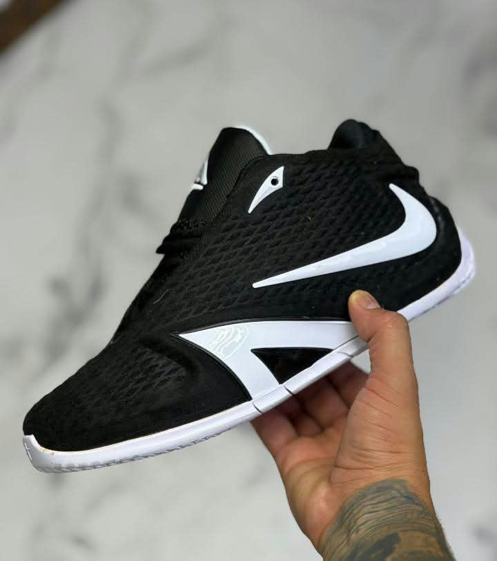

<p align="center">
  
</p>

<h1 align="center">NaySport</h1>

<p align="center">
  Sistema de escritorio para tienda de moda y calzado femenino en Windows.<br>
  Tienda online, punto de venta en caja, control de inventario por color, proveedores, tasa BCV en vivo y reportes en PDF.
</p>

---

**NaySport** es una aplicación de escritorio desarrollada en Flutter para Windows que integra en un solo programa la **tienda visual para clientes** y el **sistema interno de gestión** (caja física, inventario, Kardex, proveedores y administración).

Al abrir el programa muestra una pantalla de carga inicial (*splash screen*) y luego el inicio de sesión por roles, redirigiendo automáticamente a cada usuario a su vista correspondiente sin necesidad de configurar servidores externos.

## Qué hace

- **Acceso por roles desde el inicio.** Cada perfil entra directo a lo que le corresponde: **Administrador** (control total), **Cajero** (caja física y ventas del día) o **Cliente / Visitante** (catálogo y compra online).
- **Tienda online con catálogo real.** 59 productos iniciales organizados en 6 categorías (*Casual, Deportiva, Calzado, Prendas, Perfumes y Accesorios*), buscador en tiempo real, precios en dólares (`$`) y bolívares (`Bs`), selección de color/talla con combinación de variantes, descuentos automáticos por cantidad y carrito de compras.
- **Proceso de compra online en 3 pasos.** Dirección de envío con validación por país y código postal, métodos de pago online (*PayPal, Tarjeta con validación Luhn, Pago Móvil, Zelle, Google Pay y Apple Pay*) y confirmación con descuento automático del stock por color.
- **Caja / Ventas para tienda física.** Pensada para cobrar en mostrador: búsqueda rápida por prenda o categoría, selección de color/talla/cantidad, registro de datos del cliente (*nombre completo, cédula, teléfono y dirección*), descuentos automáticos por cantidad, métodos de pago físicos (*Punto de Venta, Pago Móvil, Zelle, Efectivo `$` y Efectivo `Bs`*) y comprobante imprimible en PDF.
- **Vista limitada para el Cajero.** Incluye la pestaña **Mis ventas de hoy** con el total cobrado en `$` y `Bs` y desglose por método de pago, pero sin acceso a costos, ganancias, eliminación de ventas ni cambios de inventario o precios.
- **Inventario por color y Kardex.** Cada producto maneja existencias independientes por color, costo de compra sugerido para calcular ganancias, ajuste masivo de precios por porcentaje y registro automático de entradas, salidas, ajustes y eliminaciones en el **Kardex**.
- **Proveedores y llegadas de mercancía.** Directorio de proveedores y registro de entradas por factura, prenda, color, cantidad y costo, sumando automáticamente al inventario y dejando trazabilidad en el Kardex.
- **Resumen, Cierre del Día y reportes PDF.** Panel principal con ventas totales, ganancia estimada, alertas de stock bajo, **Cierre del Día** separado por canal (*Tienda física vs. Online*) y método de pago, además de exportación e impresión de PDFs (comprobantes, historial de ventas, stock, compras a proveedores y cierre diario).
- **Tasa del dólar en vivo (BCV).** Consulta automática de tasa **BCV Oficial** y **Paralelo** mediante `ve.dolarapi.com`, con opción de ajuste manual y funcionamiento sin conexión.

## Catálogo incluido

La aplicación ya viene precargada con 59 artículos reales listos para probar sin conexión:

<table>
  <tr>
    <td align="center"><br><sub>Calzado deportivo</sub></td>
    <td align="center"><br><sub>Ropa deportiva</sub></td>
    <td align="center"><br><sub>Moda casual</sub></td>
  </tr>
  <tr>
    <td align="center"><br><sub>Sandalias y tacones</sub></td>
    <td align="center"><br><sub>Perfumes</sub></td>
    <td align="center"><br><sub>Accesorios</sub></td>
  </tr>
</table>

## Descargar e instalar (Windows)

Si solo quieres instalar y usar **NaySport** en Windows (sin compilar nada):

1. Descarga **[`NaySport_Setup.exe`](https://github.com/Samuel-hub69/App_NaySport/releases/download/v1.0.0/NaySport_Setup.exe)** (también disponible en la raíz del repositorio y en [Releases](https://github.com/Samuel-hub69/App_NaySport/releases/tag/v1.0.0)).
2. Haz doble clic en `NaySport_Setup.exe` y sigue el asistente (**Siguiente → Instalar → Finalizar**).
3. La aplicación quedará instalada con su ícono en el Escritorio y en el Menú Inicio de Windows.

## Requisitos (solo para compilar desde código)

- **Windows** (proyecto configurado para escritorio Windows).
- **Flutter** actualizado (`>= 3.50.0` / Dart `>= 3.14.0`).
- **Visual Studio** con la carga de trabajo **Desarrollo para el escritorio con C++**.

## Cómo ejecutarlo

Clona el repositorio e instala las dependencias:

```powershell
git clone https://github.com/Samuel-hub69/App_NaySport.git
cd App_NaySport
flutter pub get
```

Para abrir la aplicación directamente con comando:

```powershell
flutter run -d windows
```

Para compilar el ejecutable de Windows (`.exe`):

```powershell
flutter build windows --release
```

El ejecutable compilado queda en `build\windows\x64\runner\Release\naysport.exe` *(debe ejecutarse dentro de esa misma carpeta junto a `data/` y las bibliotecas `.dll`)*.

Para ejecutar las pruebas automatizadas:

```powershell
flutter test
```

## Almacenamiento local

Los datos se guardan automáticamente en disco en:

```text
%APPDATA%\NaySport\naysport_db.json
```

Las imágenes nuevas que importe el administrador desde el panel se copian a `%APPDATA%\NaySport\imagenes`. En una computadora nueva el archivo se crea limpio al iniciar la aplicación con las 6 categorías y los 59 productos iniciales.

## Cómo está hecho

- **Framework:** Flutter & Dart para escritorio Windows (`material_ui`).
- **Ventana de escritorio:** `window_manager` (ventana compacta centrada para el *splash* y expansión automática al entrar).
- **Reportes:** generación de documentos con `pdf` (recibos, inventario, compras a proveedores, historial y cierre diario).
- **Seguridad local:** contraseñas almacenadas con hash SHA-256 (`crypto`) y permisos separados por rol.
- **Tasa de cambio:** consulta HTTP directa a `ve.dolarapi.com` sin bloquear la app si no hay internet.

También puedes consultar el manual rápido de uso en [`GUIA_NAYSPORT.txt`](GUIA_NAYSPORT.txt).
